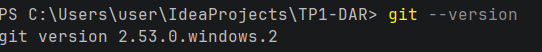
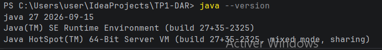

TP1 — Les sockets en mode connecté TCP

Activité 1-1 : Première connexion Client/Serveur

Matière : Développement d'applications réparties (DAR)

Année universitaire : 2026–2027

Étudiant(e) : Nour Ouaer

Classe : LSI 3

Activité 1-1 : Première connexion Client/Serveur

1. Préparation de l'environnement

1.1. Vérification de Git
La commande git --version permet de vérifier que Git est installé et reconnu par le système.

1.2. Vérification de Java
La commande java --version permet de vérifier la version de Java installée sur le système.

2. Création du serveur
Le serveur utilise une socket pour attendre la connexion d'un client. Il écoute sur le port 1234 et attend une connexion à l'aide de la méthode accept().

   Résultat obtenu:
      Interprétation
    Au démarrage, le serveur affiche un message indiquant qu'il attend la connexion d'un client. Il reste en attente jusqu'à ce qu'un client se connecte.

3. Création du client
Le client utilise une socket pour se connecter au serveur à l'adresse localhost, sur le port 1234.
   
Résultat obtenu
   
Interprétation
     Le client affiche d'abord un message indiquant qu'il n'est pas encore connecté. Lorsque la connexion réussit, il affiche un message confirmant la connexion.

4. Test de la connexion Client/Serveur
Le serveur est lancé en premier, puis le client. Lorsque le client se connecte, le serveur affiche le message confirmant la connexion.
   
5. Interprétation
     Le test montre que la connexion TCP entre le client et le serveur a réussi. À la fin du test, les sockets sont fermées. 

Activité 1-2 : Service de calculatrice

1. Objectif
L'objectif de cette activité est d'étendre l'application Client/Serveur réalisée dans l'activité 1-1 afin d'ajouter un service de calcul de multiplication.
Le client envoie un entier au serveur. Le serveur multiplie cet entier par 5, puis renvoie le résultat au client.
Cette activité permet également de comprendre la communication bidirectionnelle avec les sockets TCP et l'utilisation des classes DataInputStream et DataOutputStream.

2. Travail réalisé
Deux nouvelles classes Java ont été créées :
 Server2.java : reçoit l'entier envoyé par le client, effectue la multiplication par 5 et renvoie le résultat.
 Client2.java : permet à l'utilisateur de saisir un entier, de l'envoyer au serveur et d'afficher le résultat reçu.
La communication continue jusqu'à ce que l'utilisateur saisisse 0. Dans ce cas, le client et le serveur ferment leur connexion.

3. Implémentation du serveur
La classe Server2.java utilise un ServerSocket pour attendre la connexion du client.
Après la connexion, le serveur utilise DataInputStream pour recevoir les entiers et DataOutputStream pour envoyer les résultats. Pour chaque entier différent de zéro, il calcule le produit de cet entier par 5.
   

4. Implémentation du client
La classe Client2.java établit une connexion avec le serveur sur le port 1234.
L'utilisateur saisit un entier au clavier. Le client envoie cette valeur au serveur, attend le résultat du calcul, puis l'affiche dans la console.
La saisie se répète jusqu'à ce que l'utilisateur entre 0.

5. Exécution et tests
Le serveur est lancé avant le client. Plusieurs valeurs sont testées afin de vérifier le fonctionnement du service.
.png)

6. Conclusion
Cette activité a permis d'étendre l'application Client/Serveur TCP en ajoutant un service de multiplication côté serveur.
L'utilisation de DataInputStream et DataOutputStream permet d'échanger directement des entiers, y compris des valeurs négatives. Les tests permettent de vérifier que le serveur effectue correctement le calcul et renvoie le résultat au client.
La saisie de zéro permet de terminer la communication et de fermer les sockets.

Activité 1-3 : Communication TCP et calculatrice

1. Objectif
L'objectif de cette activité est de permettre la communication entre un client et un serveur TCP, éventuellement installés sur deux ordinateurs différents du même réseau local. Le programme est ensuite amélioré pour effectuer quatre opérations mathématiques : addition, soustraction, multiplication et division.

2. Configuration de l'adresse IP
Nous avons utilisé la classe InetAddress pour représenter l'adresse IP du serveur et la classe InetSocketAddress pour associer cette adresse à un port.
Le serveur utilise ServerSocket pour écouter les connexions entrantes sur le port 1234. Le client utilise l'adresse IP du serveur pour établir la connexion TCP.

3. Réalisation de la calculatrice
Le client propose un menu permettant de choisir une opération :
1 : Addition
2 : Soustraction
3 : Multiplication
4 : Division
0 : Quitter
Le client transmet au serveur le choix de l'opération et les deux nombres. Le serveur effectue le calcul et renvoie le résultat au client.
Les classes DataInputStream et DataOutputStream permettent d'échanger les données entre le client et le serveur.

4. Tests effectués
Nous avons testé les quatre opérations mathématiques avec différentes valeurs. Nous avons également testé la division par zéro, qui doit afficher un message d'erreur, ainsi que l'arrêt de la communication avec le choix 0.

5. Conclusion
Cette activité nous a permis de comprendre comment configurer une communication TCP à l'aide d'une adresse IP et d'un port. Nous avons également appris à échanger des données entre un client et un serveur afin de réaliser des calculs à distance et à gérer certaines erreurs.